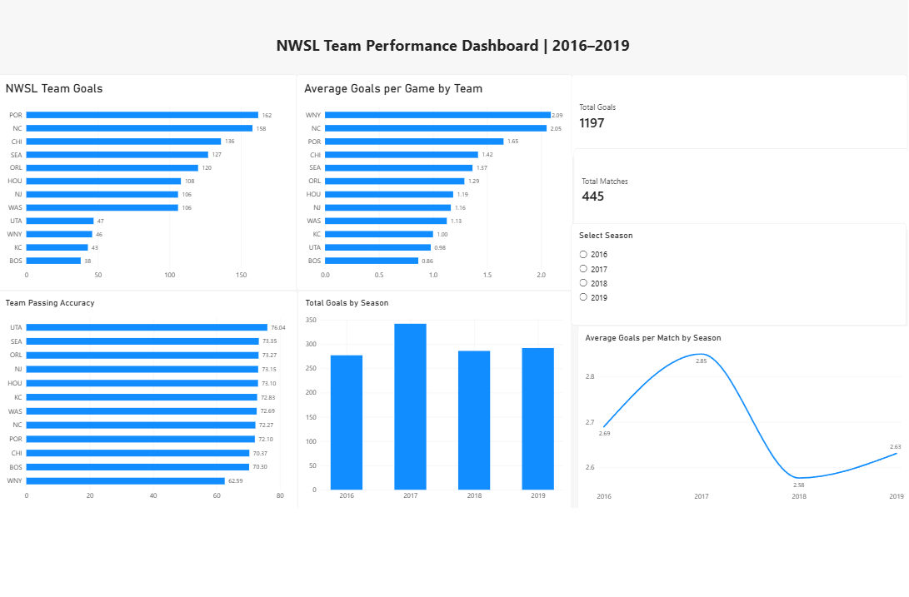
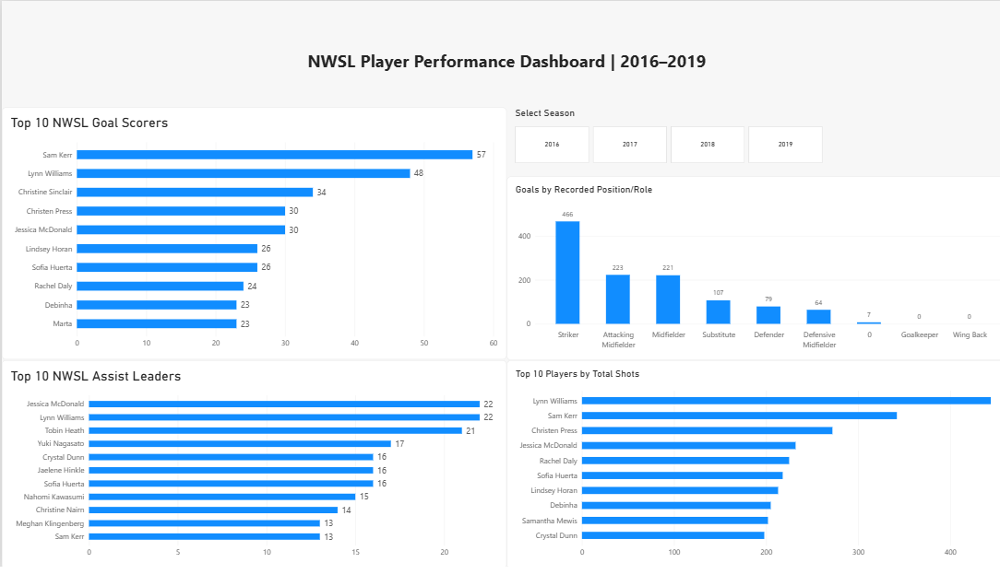

# NWSL-Performance-Analytics
Analyzing team performance, player statistics, and trends across the National Women's Soccer League

## Power BI Dashboards

### Team Performance Dashboard

### Player Performance Dashboard

## Tools & Technologies

- **Python (Pandas, Matplotlib):** Data cleaning,
  analysis, and visualizations
- **MySQL:** Database management and SQL analysis
- **Power BI:** Interactive dashboards, DAX
  measures, and data visualization
- **GitHub:** Project documentation and version control

## Key Findings

- **Top Goal Scorer:** Sam Kerr led the dataset
  with 57 goals from 2016–2019.
- **Top Assist Leaders:** Lynn Williams and
  Jessica McDonald tied with 22 assists each.
- **Team Performance:** Portland recorded the
  most total goals with 162, while Western
  New York had the highest average goals
  per game at 2.09.
- **Seasonal Trends:** Average goals per match
  peaked in 2017 at approximately 2.85.
- **Player Performance:** Lynn Williams ranked
  first in total shots across the four seasons.

  ## Data Limitations

- **Missing Data:** Some team statistics contain
  missing values, which may affect comparisons
  between teams.
- **Player Positions:** The position column
  includes both playing positions and match
  roles, such as Starter and Substitute.
- **Historical Coverage:** The analysis covers
  only the 2016–2019 seasons, so the findings
  do not represent current NWSL performance.
- **Match Records:** Team data contain separate
  records for each team in a match. Match-level
  calculations require accounting for both
  records to avoid double-counting.
